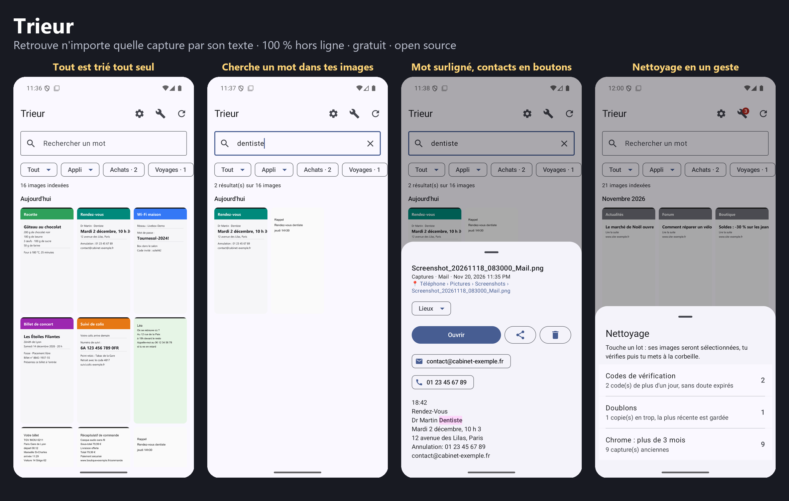

# Trieur

**English** · [Français](#français)

Android app that **finds any image by what's inside it**: screenshots, downloads, gallery, PDFs and
Office documents. Text is read (OCR) and photos are recognized **on the phone**. Free, no ads, no
account, **nothing is sent to the internet**. Interface in English and French (follows the phone's language).



- **Full-text search** in your images and documents, accent- and case-insensitive, matching words highlighted
- **Search photos by content**: "dog", "beach", "car"… (on-device image labels)
- **Automatic sorting**: purchases, travel, codes, places, documents, conversations, social media, people, animals, food…
- **Actions**: links, emails, phone numbers and codes found in an image become buttons
- **Guided cleanup**: duplicates (perceptual hash), verification codes older than a day, old screenshots per app
- **File location** shown for each result ("Phone › Download › CV.pdf")
- **Optional PC link** with [Trieur PC](https://github.com/w-koujdal/trieur-pc): search your PC from the phone
  and vice versa over your local Wi-Fi, paired with a code, end-to-end encrypted (ECDH + AES-GCM)

**Install**: download `Trieur.apk` from the [latest release](https://github.com/w-koujdal/trieur/releases/latest)
and open it on the phone (Android 10+). MIT license.

---

## Français

Appli Android qui **retrouve n'importe quelle image par ce qu'elle contient** : captures d'écran,
téléchargements, galerie et PDF. Le texte est lu (OCR) et les photos reconnues directement sur le
téléphone. Gratuit, sans pub, sans compte : **rien n'est envoyé sur Internet**.

> Né d'un fil Reddit : « je trie encore à la main ma galerie, mes captures et mes téléchargements ».

## Installer

1. Télécharger **`Trieur.apk`** dans la [dernière version](https://github.com/w-koujdal/trieur/releases/latest).
2. L'ouvrir sur le téléphone (Android 10 ou plus récent) et autoriser l'installation.
3. Optionnel : [**Trieur PC**](https://github.com/w-koujdal/trieur-pc) pour chercher dans le PC
   depuis le téléphone, et inversement, sur le même Wi-Fi.

Licence MIT.

## Ce que ça fait

| | |
|---|---|
| **Recherche plein texte** | Tape un mot : toutes les images qui le contiennent, mots surlignés. Insensible aux accents et aux majuscules, mots partiels acceptés. |
| **Recherche par contenu** | « chien », « plage », « voiture », « gâteau »… trouve les photos qui le montrent (étiquettes traduites en français). |
| **Tri automatique** | Achats, Voyages, Codes, Lieux, Documents, Conversations, Réseaux sociaux, Web, Personnes, Animaux, Nourriture, Nature, Photos. Modifiable à la main ; un choix manuel n'est jamais écrasé. |
| **Filtres** | Par source (Captures, Téléchargements, Galerie), par appli d'origine (WhatsApp, Chrome, TikTok…), par catégorie. Combinables. |
| **Actions** | Liens, e-mails, numéros et codes trouvés dans le texte deviennent des boutons (ouvrir, écrire, appeler, copier). Partager, mettre à la corbeille. |
| **Nettoyage guidé** | Doublons (le plus récent est gardé), codes de vérification périmés, vieilles captures par appli, captures sans texte. Un lot = une sélection prête à vérifier. Jamais de lot « vieilles photos » pour l'appareil photo. |
| **Sélection multiple** | Appui long, puis « Tout », partager ou corbeille en une confirmation. |
| **PDF** | Dossiers choisis dans les réglages (sélecteur d'Android) : les 5 premières pages sont lues, vignette de la première page. Cherchable comme le reste. |
| **En arrière-plan** | Les nouvelles images sont indexées en ~10 s, appli fermée. |

## Confidentialité

- Tout est analysé sur le téléphone (ML Kit, modèles embarqués dans l'APK).
- **Aucune permission Internet** : ML Kit l'ajoute pour envoyer des statistiques à Google, elle est
  retirée explicitement (`tools:node="remove"` dans `AndroidManifest.xml`). Vérifiable avec
  `adb shell dumpsys package com.trieur.screenshots`.
- Les images ne sont jamais modifiées. La corbeille passe par la confirmation d'Android
  (`MediaStore.createTrashRequest`) et reste récupérable 30 jours.
- Permissions : lecture des images (accès partiel accepté) et redémarrage (pour la tâche périodique).

## Installer

Pas de Play Store (le compte développeur est payant). L'APK se compile gratuitement :

```powershell
# JDK : celui d'Android Studio suffit
$env:JAVA_HOME = "C:\Program Files\Android\Android Studio\jbr"
.\gradlew.bat assembleRelease          # app/build/outputs/apk/release/app-release.apk (~16 Mo)
adb install -r app\build\outputs\apk\release\app-release.apk
```

La version release est signée avec la clé décrite dans `keystore.properties` (à la racine,
hors git : `storeFile`, `storePassword`, `keyAlias`, `keyPassword`). Sans ce fichier, elle est
signée avec la clé de debug. Garder une copie de la clé : sans elle, pas de mise à jour possible.

Android 10 minimum ; APK limité à `arm64-v8a` (tous les téléphones récents). Pour un émulateur
x86_64, élargir `abiFilters` dans `app/build.gradle.kts`.

## Tester

```powershell
.\gradlew.bat testDebugUnitTest
```

Sur émulateur (gratuit, Android Studio) : la version debug contient aussi `x86_64`. Un AVD
Android 16 avec des images de test générées (ticket, billet, code SMS, adresse, doublon, PDF)
a servi à vérifier tout le parcours : accueil → permission → indexation → filtres → recherche →
panneau → actions → nettoyage → corbeille → dossier PDF.

Les règles (classement, détection de liens/numéros/codes, doublons, nettoyage, étiquettes,
sections de dates, sources) sont en Kotlin pur et testées sans téléphone.

## Architecture

```
app/src/main/java/com/trieur/screenshots/
├── TrieurApp.kt              dépendances, sources activées, reclassement quand les règles changent
├── data/
│   ├── Screenshot.kt         entité Room + index plein texte FTS4 (texte et étiquettes)
│   ├── ScreenshotDao.kt      requêtes (filtres facultatifs), requête FTS sûre
│   ├── AppDatabase.kt        base v6 et migrations 1→6
│   ├── Classifier.kt         catégorie (règles sur le texte, appli d'origine, étiquettes)
│   ├── Labels.kt             étiquettes ML Kit → français + catégorie, priorité sujet > décor
│   ├── Detected.kt           liens, e-mails, numéros FR, codes
│   ├── Duplicates.kt         dHash 64 bits + similarité de texte
│   ├── Cleanup.kt            lots de nettoyage proposés
│   └── Source.kt, Category.kt, Highlight.kt
├── scan/
│   ├── ScreenshotScanner.kt  MediaStore → OCR + étiquetage sur image réduite → base
│   ├── IndexJobService.kt    JobScheduler : nouvelle image (déclencheur de contenu) + toutes les 12 h
│   ├── PdfSource.kt          dossiers choisis (SAF), rendu des pages (PdfRenderer), vignettes
│   ├── ImageHash.kt          empreinte visuelle (barres système ignorées)
│   └── MediaAccess.kt        permissions selon la version d'Android
└── ui/                       Compose : écran principal, filtres, grille par date, panneaux
```

Choix notables :

- **JobScheduler plutôt que WorkManager** : sur Galaxy S24 (Android 16), WorkManager annulait la
  tâche déclenchée par une nouvelle image quand l'appli était fermée.
- **OCR sur image réduite à 2 560 px** (ImageDecoder, orientation EXIF respectée) : une photo de
  50 Mpx décodée en entier ferait ~200 Mo en mémoire. Mesuré : 687 photos en ~7 min, pic ~320 Mo.
- **Doublon = image proche ET texte proche** ; sans texte, seuil d'image plus strict.
- **Code natif compressé** dans l'APK : 28,7 → 16,1 Mo.

## Robustesse

Une relecture de code (agent dédié) a trouvé puis fait corriger, chaque correctif vérifié :

- avec l'accès limité « photos choisies » (Android 14+), un scan vidait l'index — il n'efface
  plus rien sans accès complet ;
- une image illisible au moment du scan n'est plus enregistrée « sans texte » (et proposée à la
  corbeille) : elle est relue au scan suivant ;
- une image retouchée sur place est relue (date de modification, base v6) ;
- doublons groupés autour de l'image gardée (plus d'enchaînement A≈B≈C) ;
- PDF très haut plafonné, erreurs mémoire attrapées par fichier ;
- les deux tâches d'arrière-plan ne s'annulent plus l'une l'autre.

## Limites connues

- PDF : seulement les dossiers choisis (Android interdit la racine de Download, choisir un sous-dossier),
  5 premières pages, pas de corbeille depuis l'appli. Les PDF protégés par mot de passe sont ignorés.
- L'OCR est optimisé pour l'alphabet latin.
- Si l'appli est « forcée à l'arrêt » ou mise en veille profonde par Samsung, l'indexation en
  arrière-plan s'arrête jusqu'à la prochaine ouverture.

## Mes appareils (même Wi-Fi)

Le Trieur cherche aussi dans ton PC, et ton PC cherche dans ton téléphone, avec **Trieur PC**
(projet `trieur-pc`, à côté de celui-ci). Tout passe par le réseau local :

- **Découverte** : message UDP « TRIEUR-DISCOVER 1 » diffusé sur le port 47130, réponse JSON.
- **Appairage** une fois, avec le code à 6 chiffres affiché par l'autre appareil (usage unique,
  5 essais par minute et par adresse, nouveau code après 10 erreurs) : échange de clés publiques
  ECDH P-256, d'où chaque appareil tire la même clé secrète, jamais transmise.
- **Recherche** `GET /api/search` et **fichier** `GET /api/file` sur le port 47131 (protocole 2) :
  `X-Trieur-Peer: <id>` et paramètres chiffrés dans `X-Trieur-Box` ; réponse en trames
  AES-256-GCM numérotées (nom du fichier compris, fin authentifiée). Voir `lan/LanCrypto.kt`,
  identique dans Trieur PC. Résultat : nom, chemin lisible (« PC › Documents › CV.pdf »), extrait.
- Limite connue : quelqu'un qui contrôlerait le Wi-Fi **pendant l'appairage** et lirait le code
  pourrait s'interposer. Appairer chez soi, pas sur un Wi-Fi public.
- Seules les adresses privées (192.168.x, 10.x, 172.16-31.x) sont contactées ou acceptées.
- Côté téléphone, le serveur ne tourne que si « Visible sur le Wi-Fi » est allumé (notification).
- La permission Internet sert à ce réseau local ; l'envoi de statistiques de ML Kit est retiré
  du manifeste.
- Aucune sauvegarde : ni Google Drive, ni transfert vers un nouveau téléphone (`data_extraction_rules.xml`).
  Pas de journaux dans la version publiée.
